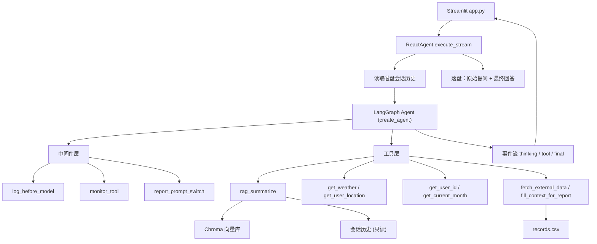

# 智扫通 · 扫地机器人智能客服

基于 **LangChain ReAct Agent + RAG** 的扫地/扫拖机器人领域智能客服系统。
支持多轮会话记忆、知识库检索增强、工具调用（天气 / 定位 / 使用记录）、以及个人使用报告自动生成。

## 功能特性

| 能力 | 说明 |
|---|---|
| **ReAct 自主推理** | 模型自主判断「信息是否足够 → 是否需要调工具 → 再判断」，单轮最多 5 次工具调用 |
| **RAG 检索增强** | Chroma 向量库 + 通义 Embedding，检索维护保养 / 故障排除 / 选购指南等资料后总结回答 |
| **多轮会话记忆** | 按 `session_id` 落盘到本地 JSON，跨请求恢复上下文 |
| **RAG 历史增强** | RAG 子链读取最近窗口历史，理解「它 / 这个 / 那」等指代，并复用用户自述信息 |
| **流式事件输出** | Agent 把 state 流翻译成 `thinking / tool / final` 事件，前端边思考边展示 |
| **个人使用报告** | 识别报告意图后动态切换提示词，按固定流程取 ID → 月份 → 使用记录 → 生成 Markdown 报告 |
| **双层监控** | 中间件记录模型调用阶段与工具耗时，全链路可观测 |

## 技术栈

- **运行时**：Python 3.10
- **Agent 框架**：LangChain（`create_agent`）+ LangGraph（`Runtime` / `ToolRuntime` / 中间件）
- **模型**：通义千问 `qwen-max`（ChatTongyi）、`text-embedding-v3`（DashScopeEmbeddings）
- **向量库**：Chroma（本地持久化）
- **前端**：Streamlit
- **配置**：PyYAML

## 目录结构

```
smart_sweeper_agent/
├── agent/
│   ├── react_agent.py      # Agent 初始化 + 流式执行，输出 thinking/tool/final 事件
│   └── middleware.py       # 三个中间件：工具监控、模型监控、报告提示词切换
├── app/
│   └── app.py              # Streamlit 前端入口（真正的启动文件）
├── rag/
│   ├── rag_service.py      # 检索 + 历史注入 + 总结链
│   └── vector_store.py     # 文档加载、切分、MD5 去重、向量库读写、检索器
├── tools/
│   └── agent_tools.py      # 7 个工具：RAG/天气/定位/用户ID/月份/使用记录/报告标记
├── model/
│   └── factory.py          # 模型工厂（ChatTongyi + DashScopeEmbeddings）
├── messageMemory/
│   ├── file_history_store.py   # 会话历史文件存储（按 session_id 一个文件）
│   └── message_history/        # 运行时生成的历史文件
├── prompts/
│   ├── main_prompt.txt         # 主系统提示词（ReAct 规则 + 工具说明）
│   ├── rag_summarize.txt       # RAG 总结提示词（资料 + 历史 + 约束）
│   └── report_prompt.txt       # 报告场景提示词
├── config/
│   ├── rag.yml                 # 模型名、历史路径、历史窗口
│   ├── chroma.yml              # 切分参数、k、数据目录、MD5 记录
│   ├── agent.yml               # 外部数据路径
│   └── prompts.yml             # 三个提示词文件路径
├── utils/
│   ├── config_handler.py       # YAML 配置加载
│   ├── file_handler.py         # PDF/TXT 加载、MD5 计算、文件遍历
│   ├── logger_handler.py       # 控制台 INFO + 文件 DEBUG 日志
│   ├── path_tool.py            # 统一绝对路径
│   └── prompt_loader.py        # 提示词读取
├── Data/                       # 知识库源文件 + 外部使用记录
│   ├── external/records.csv
│   ├── 维护保养.txt / 故障排除.txt / 选购指南.txt / 扫拖一体机器人100问.txt
│   └── 扫地机器人100问.pdf
├── chroma_db/                  # 向量库持久化目录（可重建）
├── logs/                       # 每日日志 agent_YYYYMMDD.log
├── md5.txt                     # 已入库文件 MD5（增量更新用）
└── main.py                     # PyCharm 默认模板，未使用
```

## 快速开始

### 1. 安装依赖

```powershell
cd "D:\PyCharm 2021.3\smart_sweeper_agent"
.\venv\Scripts\activate
pip install langchain langchain-community langchain-core langchain-chroma langchain-text-splitters langgraph dashscope chromadb pypdf streamlit pyyaml
```

建议锁定版本：

```powershell
pip freeze > requirements.txt
```

### 2. 配置 API Key

```powershell
$env:DASHSCOPE_API_KEY = "sk-xxxxxxxx"
```

`ChatTongyi` 与 `DashScopeEmbeddings` 都依赖这个环境变量。

### 3. 构建 / 更新向量库

```powershell
python -m rag.vector_store
```

- 首次运行会把 `Data/` 下的 txt、pdf 切分入库；
- 之后按 **MD5 去重**，已入库文件自动跳过，只处理新增/修改的文件。

### 4. 启动 Web 界面

```powershell
streamlit run app/app.py
```

### 5. 命令行调试 Agent

```powershell
python -m agent.react_agent
```

会使用固定会话 `session_test` 连问两轮，便于验证多轮记忆。

## 配置说明

### `config/rag.yml`

| 键 | 说明 |
|---|---|
| `chat_model_name` | 对话模型，默认 `qwen-max` |
| `embed_model_name` | 嵌入模型，默认 `text-embedding-v3` |
| `message_history_path` | 会话历史存储目录 |
| `rag_history_window` | RAG 读取的历史窗口（**消息条数**，12 ≈ 6 轮问答） |

### `config/chroma.yml`

| 键 | 说明 |
|---|---|
| `chunk_size` / `chunk_overlap` | 切分粒度，当前 400 / 50 |
| `separator` | 切分分隔符（建议使用全角中文标点） |
| `k` | 每次检索返回条数，当前 6 |
| `collection_name` | Chroma 集合名 |
| `persist_directory` | 向量库目录 |
| `data_path` | 知识库源目录 |
| `md5_hex_store` | 已入库文件 MD5 记录 |
| `allow_knowledge_file_type` | 允许入库的文件后缀 |

### `config/agent.yml`

| 键 | 说明 |
|---|---|
| `external_data_path` | 模拟外部系统的使用记录 CSV |

### `config/prompts.yml`

三个提示词文件的相对路径，统一由 `utils/prompt_loader.py` 读取。

## 架构与数据流



单轮时序：

1. 前端调用 `execute_stream(query, session_id)`；
2. 从磁盘读取历史，只保留「用户原始提问 + 最终回答」，拼进 `messages`；
3. `agent.stream(..., context={"report": False, "session_id": session_id})`；
4. Agent 循环：思考 → 调工具 → 观察结果 → 再思考，直到信息足够；
5. 每条新消息被翻译成 `thinking`（带 tool_calls 的过渡话术）/ `tool`（工具结果）/ `final`（最终回答）；
6. 流结束后把本轮「提问 + 回答」写回磁盘历史；
7. 前端渲染折叠的思考过程，并对最终回答做打字机输出。

## 核心机制

### 1. ReAct 循环与工具

主提示词（`prompts/main_prompt.txt`）约束了「先判断信息是否足够 → 需要则调工具 → 再判断」的流程，并规定：

- 工具入参必须与定义一致，纯文本无引号；
- 调用 `rag_summarize` 时，`query` 必须**脱离上下文也能独立检索**（把「它」「那」补全），但不得拼入无关历史信息；
- 用户已自述的城市、面积、宠物、预算等信息直接复用，禁止重复追问；
- 5 次工具调用仍不足则回复「我不知道」。

### 2. 中间件（`agent/middleware.py`）

| 中间件 | 职责 |
|---|---|
| `monitor_tool` | 记录工具名、参数、耗时、异常；并把报告标记写入 `runtime.context` |
| `log_before_model` | 记录调用阶段（初始调用 / 处理用户输入 / 消化工具结果）、上下文规模、已执行工具次数 |
| `report_prompt_switch` | 报告意图触发后，动态把系统提示词换成 `report_prompt.txt` |

### 3. 会话历史

- 一个 `session_id` 对应一个 JSON 文件，存放在 `messageMemory/message_history/`；
- 只写入 `HumanMessage(原始提问)` 和 `AIMessage(最终回答)`，**不写入带 tool_calls 的过渡消息**；
- 读取侧统一过滤，并按配置窗口截断，避免长会话撑爆提示词。

### 4. RAG 历史增强

关键点：**`session_id` 通过运行时上下文注入，不作为工具参数**。

```
execute_stream(session_id)
  → stream(context={"report": False, "session_id": session_id})
  → 工具签名 runtime: ToolRuntime
  → (runtime.context or {}).get("session_id")
  → RagSummarizeService.rag_summarize(query, session_id)
  → get_history(session_id).messages[-rag_history_window:]
```

历史的使用边界（写入 `rag_summarize.txt`）：

- **用户自述信息**（城市、面积、户型、宠物、预算、品牌偏好）可直接用于个性化回答；
- **助手历史回答**不得作为事实引用；
- **产品参数、故障原因、耗材周期等硬知识**必须以检索资料为准，冲突时以资料为准；
- **检索词不使用历史**：检索质量由主提示词的 query 补全保证，避免向量被历史稀释。

### 5. 报告生成流程

识别到「生成 / 查询个人使用报告」意图后，按固定顺序执行：

```
get_user_id → get_current_month → fill_context_for_report → fetch_external_data → 生成 Markdown 报告
```

`fill_context_for_report` 被调用时，`monitor_tool` 会往 `runtime.context` 写入 `report_prompt_switch=True`，
随后 `report_prompt_switch` 中间件把系统提示词切换成报告模板。

### 6. 知识库加载与增量更新

1. 遍历 `Data/` 下白名单后缀（txt、pdf）；
2. 计算文件 MD5，与 `md5.txt` 比对，已存在则跳过；
3. `PyPDFLoader` / `TextLoader` 加载，`RecursiveCharacterTextSplitter` 切分；
4. 写入 Chroma 并落盘 MD5 记录。

> **注意**：修改 `chunk_size` / `chunk_overlap` / `separator` / 嵌入模型后，必须删除 `chroma_db/` 和 `md5.txt` 重新构建，否则旧向量不会更新。

## 日志

- 位置：`logs/agent_YYYYMMDD.log`
- 控制台：`INFO` 及以上
- 文件：`DEBUG` 及以上（含工具参数、模型阶段、提示词片段）

关键日志：

```
[模型监控]开始调用模型，阶段：消化工具结果，上下文消息数：5，已执行工具次数：2
[模型思考]：了解您现在位于杭州……
调用工具get_weather，参数：{'city': '杭州'}
工具get_weather调用成功，耗时0.00秒
```

## 常见问题

**1. `ModuleNotFoundError: No module named 'agent'`**
在项目根目录执行命令；若仍报错，设置 `$env:PYTHONPATH = "."`。

**2. 路径含空格导致脚本执行失败**
项目路径包含空格，命令中务必用引号包裹：`cd "D:\PyCharm 2021.3\smart_sweeper_agent"`。

**3. `DASHSCOPE_API_KEY` 未设置**
模型与嵌入都会失败，先确认环境变量已生效。

**4. 知识库更新后检索结果没变**
MD5 去重会跳过「文件已存在」的资料；改过切分参数或嵌入模型时，需删除 `chroma_db/` 与 `md5.txt` 重建。

**5. 检索结果发散 / 出现无关段落**
当前使用纯相似度 Top-K 检索，同一文档内的同质条目容易被一起召回。可考虑启用 MMR 检索或按条目切块。

**6. 回答与知识库口径不一致**
`Data/` 下多份资料对同一参数（如边刷寿命 2-3 个月 vs 6-12 个月）存在冲突，需在**数据层**统一口径；提示词中虽有冲突说明要求，但不能替代数据治理。

**7. 清空会话**
前端侧边栏「清空对话历史」会清空当前 `session_id` 的历史文件。

## 扩展点

| 想做的事 | 改哪里 |
|---|---|
| 新增工具 | `tools/agent_tools.py` 用 `@tool` 定义，并在 `react_agent.py` 的 `tools=[...]` 注册 |
| 新增中间件 | `agent/middleware.py`，然后加入 `create_agent(middleware=[...])` |
| 换模型 / 换嵌入 | `config/rag.yml`（换嵌入后必须重建向量库） |
| 调检索粒度与条数 | `config/chroma.yml` |
| 调历史窗口 | `config/rag.yml` 的 `rag_history_window` |
| 改回答风格与边界 | `prompts/main_prompt.txt` / `rag_summarize.txt` |
| 调整前端展示 | `app/app.py`（`TOOL_LABELS`、`render_thinking`、`char_generator`） |

## 已知限制

- 检索为纯 Top-K 相似度，缺少 MMR / 重排，同文档噪音段落可能挤占名额；
- 参考资料元数据（creator、producer 等）仍整体拼入提示词，存在 token 浪费；
- `rag_service.py` 中的 `temp()` 为调试打印，生产环境建议改为 `logger.debug` 或加开关；
- 主提示词与 RAG 提示词对历史的处理需保持口径一致，否则会出现「一个用、一个不用」的不一致；
- `main.py` 为脚手架残留，未参与业务逻辑。